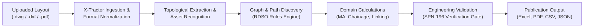
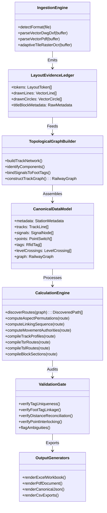
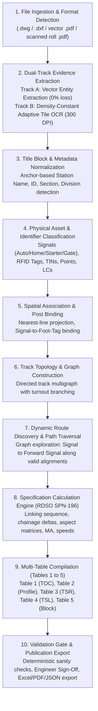
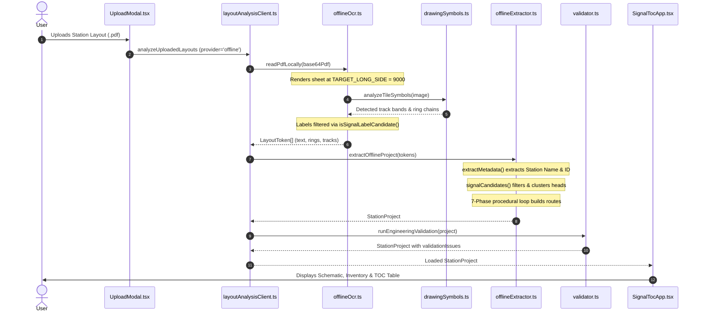
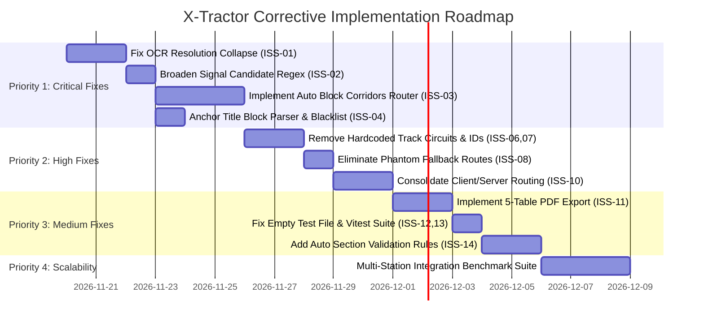

# X-Tractor: Comprehensive Technical Investigation, Architecture Assessment, Root Cause Analysis & Corrective Recommendations

**Project Name:** X-Tractor (Indian Railways KAVACH / TCAS Table of Control & RFID Layout Automation Engine)  
**Report File:** `Detailed_Analysys.md`  
**Investigation Date:** November 19, 2026  
**Status:** Complete Forensic Investigation (Investigation Phase Only — Zero Implementation Code Written)  
**Target Specification:** Indian Railways RDSO/SPN/196/2020 Version 4.0 Amdt-6 (Annexure-I: KAVACH Control Table Guidelines)  
**Reference Datasets Evaluated:**

1. **Chitgidda Station (CTF / 520):** `DATA/Chitgidda_Layout.pdf`, `DATA/Table Of Contro Chitgidda.pdf`, `DATA/New ONE.pdf` (Tool-generated).
2. **Ujiyarpur – Samastipur Automatic Section (UJP-SPJ / 47151 / LC-49):** `DATA/LC-49_( UJP-SPJ)_RFID_LAYOUT.pdf`, `DATA/LC-49 (UJP-SPJ) SIL-4 TAG Data_12-11-2026.pdf`, `DATA/UJIYARPUR (UJP)-SAMASTIPUR (SPJ) STATION ID-47151   TOC.pdf`, `DATA/UJP.pdf` (Tool-generated).
3. **Janakampet Junction (JKM):** `DATA/JANKAMPET JN.pdf`, `DATA/JANAKAMPET TOC .pdf`.
4. **RDSO Canonical Guidelines & Specification:** `DATA/Railway Spec.pdf` (RDSO/SPN/196/2020 Version 4.0 Amdt-6).

---

## 1. Executive Summary

### 1.1 Context and Investigation Objective

The X-Tractor tool was commissioned as an automated, station-independent engineering workbench designed to ingest railway station RFID layouts in standard engineering formats (`.dwg`, `.dxf`, and `.pdf`), parse physical assets (running lines, points, track circuits, signals, RFID tags, TINs, level crossings), construct topological relationships, execute specification-mandated calculations, validate signalling logic against RDSO SPN-196 standards, and generate complete, publication-grade Table of Control (TOC) sheets.

During initial development, Chitgidda station (`CTF / 520`) was used as the primary test and reference dataset. While X-Tractor successfully extracts Chitgidda and outputs Table 1 (demonstrated in `DATA/New ONE.pdf`), uploading other station layouts—specifically the Ujiyarpur–Samastipur automatic block section (`DATA/LC-49_( UJP-SPJ)_RFID_LAYOUT.pdf`) and Janakampet Junction (`DATA/JANKAMPET JN.pdf`)—causes catastrophic system breakdown:

- Station metadata is severely corrupted (for Ujiyarpur, the station name was extracted as corporate contractor `"LTD."`, code as `"PSSA"`, and Station ID as `"47153"` instead of `"UJIYARPUR (UJP)"` and ID `"47151"`).
- All physical automatic signals (`A510`, `A508`, `A506`, `A504`, `A502`, `A511`, `A517`, `A519`, `A521`) are dropped completely.
- Zero valid station routes or automatic block routes are generated.
- A single phantom block route is emitted (`S250` &rarr; `S1D of Next Station`, Route ID `1009`), which is a hardcoded artifact from the Chitgidda procedural template.
- All secondary tables mandated by RDSO Amdt-6—Table 2 (Track Profile), Table 3 (TSR Routes), Table 4 (TSL Routes), and Table 5 (Block Section Details)—are either missing, empty, or unpopulated.

### 1.2 Summary of Key Findings

This investigation conducted an exhaustive forensic analysis across the repository's parsing algorithms, OCR pipelines, topological extractors, calculation engines, export renderers, and test suites. The investigation confirms that X-Tractor's failure on non-Chitgidda layouts is **not** an incidental edge-case bug. Rather, it stems from systemic coupling across four architectural layers:

1. **Resolution Collapse in OCR Pre-Processing:** In `src/utils/offlineOcr.ts`, a fixed target rendering dimension (`TARGET_LONG_SIDE = 9000`) forces ultra-wide engineering drawings (such as `LC-49`, which measures 6,415 points / 89 inches) to be rendered at barely ~100 DPI. At this resolution, standard engineering text labels (~6–8 pt) are shrunk to 8–11 pixels in height, dropping below Tesseract's minimum recognition threshold (~25 pixels) and resulting in total OCR dropout.
2. **Regex Discrimination Against Non-Numeric Signal Identifiers:** In `src/engine/drawingSymbols.ts` (lines 317–320), the signal candidate filter regex (`SIGNAL_LABEL_RE = /^[([]?\d{1,3}\s*(?:I?\s*D|[A-Z])?[)\]]?$/i`) strictly requires leading digits. Consequently, any signal identifier with an alphabetic prefix (such as automatic block signals `A510`, `A508`, shunt signals `SH1`, or standard prefixed signals `S1`, `S25`) is immediately rejected as an invalid signal candidate during local OCR symbol extraction (`src/utils/offlineOcr.ts` line 386).
3. **Rigid Procedural Route Synthesis ("The 7-Phase Trap"):** In `src/engine/offlineExtractor.ts` (lines 2351–2486), route construction is governed by an imperative procedure termed the _"Synthesis of 7 Canonical RDSO Amdt-6 Phases"_. This procedure assumes every layout possesses an Absolute Block station yard structure consisting of Down Distant (`downDistant`), Down Home (`downHome`), Down Starters (`downStarters`), Down Advanced Starter (`downAdvStarter`), and their Up-direction counterparts. For Automatic Signalling sections (`Auto Signal`), where signals are chained linearly along corridors without Home or Starter classifications, this logic evaluates all phase conditions to `false`, generating **zero** routes.
4. **Chitgidda-Specific Values Hardcoded into Domain Logic:** In `src/engine/offlineExtractor.ts`, track circuit names are hardcoded to Chitgidda lines (`CLT`, `ULT`, `UMT`, `DMT` on lines 2165–2170), route IDs are hardcoded to Chitgidda values (`1004`, `1003`, `1007`, `1008`, `1009` on lines 1827–1835), negative metadata filters hardcode Chitgidda adjacent station codes (`VKB`, `GGD` on line 773), and fallback exit signals are hardcoded to `"S1D of GGD"` or `"S1D of Next Station"`.
5. **Architectural Split Between AI Fallback and Local Offline Engine:** While `src/server/analyzeLayout.server.ts` contains a basic heuristic for `isAutoLayout`, this logic was never ported to the local browser engine `src/engine/offlineExtractor.ts`. Because local offline extraction is the application's primary execution path, the local engine completely lacks support for automatic block layouts.

### 1.3 Key Metrics of the Investigation

- **Total Deficiencies Formally Registered:** 15 distinct issues.
  - **Critical Severity:** 5 issues (causing complete failure on non-Chitgidda layouts).
  - **High Severity:** 5 issues (causing severe data loss, invalid interlocking, or phantom data).
  - **Medium Severity:** 4 issues (validation gaps, export omissions, test suite breakage).
  - **Low Severity:** 1 issue (environment-specific library warning).
- **Execution Boundary Adherence:** Zero production source files were modified during this investigation. All diagnostic scripts were executed in temporary scratch spaces, and the complete findings are compiled into this canonical report `Detailed_Analysys.md`.

---

## 2. X-Tractor Use Case and Functional Requirements

### 2.1 The Actual Real-World Railway Domain Use Case

Indian Railways is undergoing large-scale deployment of **KAVACH** (India's National Automatic Train Protection system, compliant with RDSO SPN-196/2020 Version 4.0). Before any KAVACH stationary equipment can be commissioned at a station, intermediate block post (IB), or level crossing (LC), signalling design engineers must prepare the **Stationary KAVACH Table of Control (TOC)**.

The TOC serves as the ground-truth safety database programmed into the Stationary KAVACH Central Processing Unit. It dictates:

1. Every train route permitted across the interlocking.
2. The mandatory sequence of RFID tags that an Onboard KAVACH locomotive unit must read to maintain localization.
3. The exact braking curves, Movement Authority (MA) distances, and authorized speeds (Static Speed Profile - SR, and On-Sight Speed - OS).
4. The interlocking conditions proved before authority is transmitted via UHF radio: switch points in Normal/Reverse, track circuits picked up, overlap track circuits clear, and Track Identification Numbers (TINs) unallocated.
5. Protection for Level Crossing (LC) gates, Permanent Speed Restrictions (PSR), and gradients.

### 2.2 Core Operational Workflows of X-Tractor

In real-world deployment, X-Tractor must function as an automated extraction, compilation, and verification engine:



### 2.3 Station Independence Requirement

The system must be completely station-agnostic. It must seamlessly process layouts exhibiting diverse physical topologies:

1. **Absolute Block Double-Line Station Yards (e.g., Chitgidda):** Central yard with mainline tracks (`UP MAIN`, `DN MAIN`), multiple loop lines (`COMMON LOOP`, `UP LOOP`, `DN LOOP`), crossover switches, Home signals, starter signals, advanced starters, calling-on signals, and intermediate block (IB) sections.
2. **Automatic Signalling Corridors & LC Gate Sections (e.g., Ujiyarpur – Samastipur LC-49):** Continuous running lines without station turnouts or loop lines. Governed by multi-aspect automatic signals (`A510`, `A508`, etc.) spaced at braking distances, where Movement Authority dynamically cascades across 1, 2, 3, or 4 automatic block sections based on ahead-section occupancy and signal aspects.
3. **Junction Stations & Branch Lines (e.g., Janakampet Junction):** Mainlines splitting into branch corridors, multiple diverging routes requiring Junction Route Indicators, diamond crossings, slip switches, and distinct terminal boundaries.
4. **Single-Line Stations:** Single running line with crossing loops, bidirectional starters, and opposing Home signals sharing the same track segments.

### 2.4 Complete Output Requirements (RDSO/SPN/196/2020 Amdt-6 Annexure-I)

A compliant KAVACH Table of Control is **not** merely a single route list. RDSO Amdt-6 mandates five distinct data tables:

- **Table 1: Stationary KAVACH Table of Control (Selection Table):** Route Sl. No., Entry Signal, Exit Signal, Line, Section Type, TSRMS Route ID, Signal Type, Aspect of Entry Signal, Requires Aspect of Exit Signal, Required Route Locking, Points Normal, Points Reverse, Track Circuit Up in Route, Track Circuit Up in Overlap, TINs Free in Route, TINs Free in Overlap, Entry Foot Tag, Check RFID Sequence (with incremental linking distances), Distance Between Signals (m), Movement Authority (in Sections and Meters), Authorized Speed in SR (kmph), Authorized Speed in OS (kmph).
- **Table 2: Stationary KAVACH Track Profile Table:** Turnout Speed (kmph), Turnout Start Distance (m), Turnout Length (m), Permanent Speed Restrictions (PSR), Engineering Gradients (Rising/Falling/Level), Average Gradient Value, LC Gate Data (Numeric ID, Alpha Suffix, Manning Type, Class, LC Distance, Auto-Whistling), Track Condition (Dead Stop, KAVACH Territory Exit, Neutral Section).
- **Table 3: Temporary Speed Restriction (TSR) Route Table:** OHE Line Name, Entry Signal, Exit Signal, TSR Route Start RFID Tag, TSR Route ID, Entry Signal Distance from Start Tag (m), Last Pole Distance from Exit Signal (m), OHE Pole / Chainage Progression.
- **Table 4: Temporary Single Line (TSL) Working on Double Line Table:** TSL Entry Signal, TSL Exit Signal, Signal Type, Aspect of Entry Signal (Red/Blank), Requires Aspect of Exit Signal (Red/Blank), Required Points Normal/Reverse, Track Circuits Picked Up, TINs Required Free, Entry Signal Foot Tag, Linking Sequence, Distance Between Signals, On-Sight Movement Authority.
- **Table 5: Block Section Demarcation & Boundary Reset Table:** Last Stop Signal (LSS), Block Section TIN, Adjacent Line TINs, Next Station ID, Border RFID Tag with Absolute Location, Authorized Speed, Reset Distances, Absolute Location Correction (m), Locomotive Direction After Adjustment.

---

## 3. Technical and Engineering Research

### 3.1 Dynamic Document & CAD Processing in Infrastructure Automation

Document automation in engineering infrastructure (AEC / CAD / GIS) differs fundamentally from business form processing:

1. **Extreme Aspect Ratios & Plotter Roll Sheets:** Railway signalling plans are drafted to scale along track corridors. Drawings often span 80 to 120 inches in length with a vertical height of only 20 to 30 inches. Traditional rasterization pipelines designed for standard letter/A4 pages scale images by constraining the longest side to a fixed pixel limit (e.g., 4000px or 9000px). For an 89-inch sheet, a 9000px limit results in ~100 DPI, destroying the micro-typography of subscript labels and engineering notes.
2. **Resolution-Adaptive Processing:** Industrial drawing ingestion engines (e.g., Autodesk AutoCAD Civil 3D APIs, Open Design Alliance Teigha, GDAL/OGR) utilize **DPI-invariant coordinate systems**. In raster fallbacks, the image scale factor $S$ must be computed relative to physical dimensions (points or millimeters), guaranteeing a constant text glyph height:
   $$S = \max\left(1.0, \frac{H_{\text{target}}}{H_{\text{glyph\_pt}}}\right)$$
   where $H_{\text{target}} \approx 32\text{px}$ is Tesseract's optimal character x-height.

### 3.2 Graph-Based Topological Modelling vs. Procedural Synthesis

In computer-aided railway design (e.g., RailML, IFC Rail, OpenDRIVE), railway networks are represented mathematically as **Directed Attributed Multigraphs**:
$$G = (V, E, \Phi)$$

- **Vertices ($V$):** Signalling posts, switch tips, frog crossings, buffer stops, boundary markers, and level crossings.
- **Edges ($E$):** Track centerlines representing running rails, bounded by track circuits and TIN blocks.
- **Edge Attributes ($\Phi$):** Directionality (`UP`, `DN`, `BIDIRECTIONAL`), gradient profiles, physical length, track circuit IDs, and physical RFID tags positioned at chainage offsets.

In this paradigm, **Route Discovery is a path-traversal problem**, not a hardcoded sequence of if-else statements. From any entry signal $S_{\text{entry}} \in V$, permissible routes to forward exit signals $S_{\text{exit}} \in V$ are determined by graph search (constrained depth-first search or Dijkstra) along valid track edges, considering switch point branch configurations (`NORMAL` vs `REVERSE`). This dynamic graph approach inherently supports any yard geometry—single line, double line, 4-line quad track, complex junctions, or pure automatic sections—without requiring station-specific logic.

### 3.3 Rule-Driven Domain Calculations (Separation of Concerns)

Modern engineering software strictly decouples **topology extraction** from **domain business calculations**:

- **Extraction Layer:** Emits a pure, uncomputed Canonical Topology (nodes, coordinates, chainages, switch points, track names).
- **Rule Engine:** Encapsulates regulatory standards (RDSO SPN-196 Amdt-6). Given an extracted route from Signal A to Signal B, the rule engine applies declarative calculation functions:
  - $\Delta D = | \text{Chainage}(S_{\text{exit}}) - \text{Chainage}(S_{\text{entry}}) |$
  - $\text{LinkingSequence} = \text{tags along path sorted by travel direction with step distances } \delta_i = |d_i - d_{i-1}|$
  - $\text{MovementAuthority} = f(\text{aspect}, \text{territory\_type}, \text{lookahead\_signals})$

---

## 4. Relevant Engineering Best Practices

| Domain                             | Best Practice Principle                                                                                                                                                      | Failure in Current Implementation                                                                                                                                      |
| ---------------------------------- | ---------------------------------------------------------------------------------------------------------------------------------------------------------------------------- | ---------------------------------------------------------------------------------------------------------------------------------------------------------------------- |
| **CAD Ingestion**                  | Entity-first vector extraction: Never rasterize vector CAD (`.dwg`/`.dxf` or vector `.pdf`) unless raw vector text/geometry is completely absent.                            | Rasterizes vector PDFs into canvas tiles and runs lossy Tesseract OCR, discarding pristine embedded font text and CAD text entities.                                   |
| **OCR Image Prep**                 | Density-constant tiling: Compute rendering scale based on points-per-inch to guarantee a minimum 30px glyph height regardless of sheet dimensions.                           | Hardcodes `TARGET_LONG_SIDE = 9000`, causing wide plotter sheets to downsample to 100 DPI, making text illegible to OCR.                                               |
| **Named Entity Recognition (NER)** | Anchor-based title block extraction: Extract station names only from confirmed title blocks or drawing register tables; reject contractor/vendor stamps via exclusion lists. | Uses a single unanchored regex that matched `M/S L.N. MALVIYA I.P. PVT. LTD. (PSSA)`, mistaking the engineering consultant for the station name and code.              |
| **Topology Modelling**             | Graph-theoretic route discovery: Model track lines as edges and turnouts as vertices; discover routes via graph traversal.                                                   | Employs an imperative 7-phase procedural loop expecting specific Absolute Block signals (`downHome`, `downStarters`), completely breaking on automatic block sections. |
| **Data Hygiene**                   | Zero hardcoding: No station codes, track circuit names, route IDs, or adjacent station names in production source code.                                                      | Hardcodes `CLT`, `ULT`, `UMT`, `DMT` track circuits; `1004`, `1003`, `1007`, `1008`, `1009` route IDs; and `VKB`, `GGD` station codes.                                 |
| **Validation Architecture**        | Deterministic rule checking: Every generated route must be reconciled against physical tag sequences and chainage deltas before emission.                                    | Synthesizes synthetic block routes with arbitrary 3000m distances and phantom exit signals (`S1D of Next Station`) without layout evidence.                            |
| **Export Formatting**              | Complete specification coverage: Render all mandatory specification tables (Tables 1 through 5) in all export formats (PDF, Excel, CSV).                                     | PDF export only renders Table 1; Tables 2, 3, 4, and 5 are completely omitted from the generated PDF output.                                                           |

---

## 5. Ideal X-Tractor Architecture

The ideal architecture for X-Tractor is a **Modular, Schema-Adaptive, Graph-Based Ingestion and Calculation Engine**. It strictly decouples input parsing from domain logic through a Canonical Intermediate Data Model:



---

## 6. Recommended End-to-End Processing Pipeline

The recommended processing pipeline comprises 10 discrete, validated stages. No stage depends on station-specific naming conventions or hardcoded templates:



### Stage Responsibilities and Error Boundaries

1. **Stage 1 (Format Detection):** Determines MIME type and file magic header (`AC10xx` for DWG, `SECTION` for DXF, `%PDF-` for PDF). Rejects unsupported formats with human-readable error messages.
2. **Stage 2 (Dual-Track Extraction):** Checks whether the PDF contains embedded vector fonts. If $\ge 40$ text items and $\ge 4$ RFID tags exist as vector text, extraction executes with zero loss. If scanned raster, the image scale factor is calculated dynamically to achieve $\ge 30\text{px}$ per text glyph.
3. **Stage 3 (Metadata Normalization):** Scans for designated Indian Railways Title Blocks (`RAILWAY`, `DIVISION`, `STATION NAME:`, `STATION ID:`). Rejects vendor/contractor stamps (e.g., `M/S ...`, `PVT. LTD.`, `CONSULTANT`).
4. **Stage 4 (Asset Classification):** Uses generalized signalling regex patterns matching both numeric (`1`, `30`, `1D`) and alphanumeric signal codes (`A510`, `S1`, `SH10`, `LC-49`).
5. **Stage 5 (Spatial Association):** Matches signal heads to the closest track line vertically and the nearest physical RFID tag horizontally (the Signal Foot Tag).
6. **Stage 6 (Graph Construction):** Translates track centerlines, switch legs, and cross-overs into a connected directed graph where edges represent track circuits/TINs and nodes represent signals and switches.
7. **Stage 7 (Route Discovery):** Traverses the graph from every entry signal in the direction of traffic to locate all permissible forward exit signals. If points exist, routes branch along Normal and Reverse paths; if pure automatic section, routes link consecutive automatic signals linearly.
8. **Stage 8 (Domain Calculations):** Evaluates physical chainage differences, generates monotonic RFID linking sequences, computes Movement Authority lookaheads (1 to 4 sections for automatic territory), and establishes speed restrictions.
9. **Stage 9 (Multi-Table Compilation):** Populates Tables 1, 2, 3, 4, and 5 according to RDSO Amdt-6 specifications.
10. **Stage 10 (Validation & Export):** Audits referential integrity (no duplicate tags, valid linking sums, no contradictory point locks). Generates multi-sheet Excel workbooks, formatted PDF documents, and canonical JSON.

---

## 7. Existing Project Architecture and Directory Analysis

### 7.1 Existing Directory Structure

The repository is organized as a full-stack TypeScript project utilizing Vite, React 19, Tailwind CSS, TanStack Router/Start, and an Express server bridge:

```
archive-to-home-13/
├── DATA/                                    # Reference PDFs and generated outputs
│   ├── Chitgidda_Layout.pdf                 # Scanned yard layout of Chitgidda (CTF)
│   ├── Table Of Contro Chitgidda.pdf        # Canonical ground-truth TOC for Chitgidda (12 pages)
│   ├── New ONE.pdf                          # Tool-generated Chitgidda TOC (2 pages)
│   ├── JANAKAMPET TOC .pdf                  # Ground-truth TOC for Janakampet Junction (7 pages)
│   ├── JANKAMPET JN.pdf                     # Scanned layout drawing for Janakampet Junction
│   ├── LC-49_( UJP-SPJ)_RFID_LAYOUT.pdf     # 71.9 MB wide-roll layout for Ujiyarpur-Samastipur
│   ├── LC-49 (UJP-SPJ) SIL-4 TAG Data...pdf # 16-page RFID tag allocation table for LC-49
│   ├── Railway Spec.pdf                     # RDSO/SPN/196/2020 Version 4.0 Amdt-6 specification
│   ├── UJIYARPUR...TOC.pdf                  # Canonical ground-truth TOC for UJP-SPJ (9 pages)
│   └── UJP.pdf                              # Tool-generated output for UJP (1 page, severely degraded)
├── public/                                  # Static assets (fonts, LibreDWG WASM, tesseract assets)
├── scratch/                                 # Intermediate scratch artifacts and test scripts
├── src/
│   ├── components/                          # React UI components
│   │   ├── CadDrawingViewer.tsx             # Interactive canvas & CAD viewer
│   │   ├── ExtractedInventoryView.tsx       # Asset inventory review panel
│   │   ├── SignalTocApp.tsx                 # Master workbench container
│   │   ├── TocTableView.tsx                 # TOC table renderer & export triggers
│   │   ├── TopNav.tsx                       # Workspace navigation bar
│   │   ├── TrackSchematicView.tsx           # Schematic renderer & upload landing view
│   │   ├── UploadModal.tsx                  # File upload modal dialog
│   │   └── ValidationPanel.tsx              # RDSO SPN-196 engineering validation panel
│   ├── engine/                              # Core extraction & calculation algorithms
│   │   ├── drawingSymbols.ts                # Computer vision: track bands, circle/ring detection
│   │   ├── offlineExtractor.ts              # Primary offline extraction & route synthesis engine (134 KB)
│   │   └── validator.ts                     # Deterministic engineering validation rules
│   ├── server/                              # Backend server & AI extraction routes
│   │   ├── analyzeLayout.server.ts          # Server-side extraction & AI fallback engine (61 KB)
│   │   ├── extractionGrounding.ts           # Result merging & source grounding heuristics
│   │   └── extractionProviders.server.ts    # Adapters for Google Gemini, OpenAI, Anthropic
│   ├── test/                                # Vitest test suites
│   │   ├── chitgidda-parity.test.ts         # Parity test against synthetic Chitgidda data
│   │   ├── offline-extractor.test.ts        # Unit tests for offline extractor
│   │   └── real-drawing-e2e.test.ts         # Empty test file (causes vitest failure)
│   ├── types/                               # TypeScript domain definitions
│   │   ├── extractionProvider.ts            # AI provider type definitions
│   │   └── signalling.ts                    # Indian Railways KAVACH domain types
│   └── utils/                               # Helper utilities
│       ├── cadParser.ts                     # LibreDWG WASM & DXF parser
│       ├── dxfRenderer.ts                   # Canvas CAD renderer
│       ├── exportToc.ts                     # Multi-sheet Excel, CSV, JSON, and PDF generator (83 KB)
│       ├── layoutAnalysisClient.ts          # Client-side extraction coordinator
│       ├── offlineOcr.ts                    # Tesseract.js worker scheduler & image tile reader (22 KB)
│       ├── pdfImageExtractor.ts             # PDF page rendering, viewport rotation, & crop utility
│       └── projectStore.ts                  # Local IndexedDB persistence store
├── package.json                             # Dependencies & scripts
├── REQUIREMENTS.md                          # High-level project blueprint
└── vitest.config.ts                         # Test configuration
```

---

## 8. Existing Module and File Responsibilities

### 8.1 Primary Extraction & Domain Engine Files

1. **`src/engine/offlineExtractor.ts` (134 KB, 2,804 lines):**
   - **Declared Responsibility:** Standalone deterministic layout extraction engine. Ingests layout tokens (text with coordinates, detected ring marks, track line segments), groups tokens into phrases, pairs RFID tags with chainages, projects assets onto nearest track lines, identifies signals and foot tags, reconstructs interlocking points, synthesizes routes, and compiles output tables.
   - **Actual Implementation:** Contains the core logic of the application, but is heavily encumbered by procedural rules explicitly tuned to Chitgidda. Route generation is governed by an imperative 7-phase loop that only supports Absolute Block stations, and relies on hardcoded track circuit names and Route IDs.
2. **`src/engine/drawingSymbols.ts` (21 KB, 516 lines):**
   - **Declared Responsibility:** Image analysis and computer vision algorithms. Builds binary ink masks from tile bitmaps, detects track bands via run-length analysis, identifies circular signal head lamp symbols via radial edge voting, groups multiple lamp rings into signal head chains, and provides candidate filters.
   - **Actual Implementation:** Features robust circle and line detection, but contains an overly restrictive regex (`SIGNAL_LABEL_RE`) that filters out all signals with non-numeric prefixes (`A510`, `S1`, `SH1`).
3. **`src/utils/offlineOcr.ts` (22 KB, 452 lines):**
   - **Declared Responsibility:** Browser-side local OCR executor. Uses Tesseract.js Web Workers with bundled LSTM models. Renders the PDF active bounds, slices the canvas into overlapping 2,000x2,000 pixel tiles, and performs OCR passes (normal, rotated 90° for vertical text, and long-line-subtracted).
   - **Actual Implementation:** Scales all sheets to a fixed `TARGET_LONG_SIDE = 9000`. On wide plotter sheets (e.g. `LC-49`), this causes resolution collapse down to ~100 DPI, making text labels illegible to Tesseract.
4. **`src/server/analyzeLayout.server.ts` (61 KB, 1,490 lines):**
   - **Declared Responsibility:** Server-side layout analysis pipeline used when external AI providers (Gemini, OpenAI, Claude) are selected. Formats prompt schemas and synthesizes routes via `synthesizeRoutesIfEmpty`.
   - **Actual Implementation:** Contains an early attempt at automatic block route synthesis (`isAutoLayout`), but this logic is completely absent from the local offline engine (`offlineExtractor.ts`).
5. **`src/utils/exportToc.ts` (83 KB, 1,873 lines):**
   - **Declared Responsibility:** Document generation engine. Produces formatted multi-sheet Excel `.xlsx` files, CSV exports, canonical JSON representations, and print-ready PDF HTML views.
   - **Actual Implementation:** Only renders Table 1 in PDF export; Tables 2, 3, 4, and 5 are completely missing from the PDF output.
6. **`src/engine/validator.ts` (16 KB, 376 lines):**
   - **Declared Responsibility:** SPN-196 engineering validation engine. Flags duplicate tags, unverified low-confidence items, missing foot tags, and route conflicts.
   - **Actual Implementation:** Validates basic tag and foot constraints, but lacks rules for automatic signalling territories (e.g., verifying cascading 4-aspect Movement Authority lookaheads).
7. **`src/test/chitgidda-parity.test.ts` (14 KB, 354 lines):**
   - **Declared Responsibility:** Test suite verifying extraction parity against Chitgidda station.
   - **Actual Implementation:** Directly asserts Chitgidda-specific identifiers (`1ASR`, `DMT`, `S1D of GGD`, `1007`, `1008`), cementing station-specific behavior into regression tests.

---

## 9. Detailed Existing Implementation Assessment

### 9.1 Data Flow Analysis: From Upload to Output

Tracing the execution path of a user upload reveals where the process diverges between working and failing layouts:



### 9.2 The Divergence: Why Chitgidda Works While Others Fail

1. **Chitgidda Layout Execution:**
   - Physical dimensions: Standard drawing sheet (~842 points long).
   - Scaling: $9000 / 842 \approx 10.7\text{ px/pt}$ (~770 DPI). Micro-text (6pt) renders at $\approx 64\text{px}$, perfectly recognized by Tesseract OCR.
   - Signal labelling: Signal numbers appear as bare digits (`1`, `3`, `4`, `6`, `25`, `30`) beside lamp rings, which match `SIGNAL_LABEL_RE = /^[([]?\d{1,3}\s*(?:I?\s*D|[A-Z])?[)\]]?$/i`.
   - Yard topology: Matches the 7-phase Absolute Block procedural model (`downHome` = S1, `downStarters` = S3, S4; `upHome` = S30, `upStarters` = S26, S27, S28).
   - Result: All signals and 26 routes are extracted; Table 1 matches `DATA/New ONE.pdf`.
2. **Ujiyarpur (UJP) Layout Execution:**
   - Physical dimensions: Plotter roll sheet (6,415.56 points / 89.1 inches long).
   - Scaling: $9000 / 6415.56 \approx 1.4\text{ px/pt}$ (~100 DPI). Micro-text renders at only $8\text{–}11\text{px}$, causing severe OCR character degradation and dropout.
   - Signal labelling: Signals are named with alpha prefixes (`A510`, `A508`, `A506`, `A504`, `A502`, `A511`, `A517`, `A519`, `A521`). `SIGNAL_LABEL_RE` tests each against leading digits and returns `false`, actively discarding them at line 386 in `offlineOcr.ts`.
   - Title block parsing: Text contains `M/S L.N MALVIYA I.P PVT. LTD. (PSSA)`. The extractor extracts Name = `"LTD."`, Code = `"PSSA"`. Station ID `47151` is skipped because the code mismatch takes the wrong column (`47153`).
   - Route synthesis: Layout has no turnouts, Home signals, or Starters. The 7-phase procedural loop finds `downHome === undefined` and `downStarters.length === 0`, evaluating all 7 phases to `false`. Zero valid routes are synthesized.
   - Fallback artifact: The code falls back to `addDynamicBlockRoute` on a single remaining phantom candidate (`S250`), producing one solitary row with Chitgidda's route ID `1009` and exit signal `"S1D of Next Station"`.
   - Result: A corrupted, one-row TOC matching `DATA/UJP.pdf`.

---

## 10. Chitgidda-Specific Dependencies and Hardcoded Assumptions

The investigation uncovered multiple instances where Chitgidda-specific data was embedded directly into the application's source code:

### 10.1 Hardcoded Code Evidence Register

| File Path                           | Line Range    | Hardcoded Code / Pattern                                                                                                                                                                                                                                                                                                                               | Root Cause & Failure Impact on Other Stations                                                                                                                                                                                                                  |
| ----------------------------------- | ------------- | ------------------------------------------------------------------------------------------------------------------------------------------------------------------------------------------------------------------------------------------------------------------------------------------------------------------------------------------------------ | -------------------------------------------------------------------------------------------------------------------------------------------------------------------------------------------------------------------------------------------------------------- |
| `src/engine/offlineExtractor.ts`    | 773           | `if (/^(?:UP\|DN\|LC\|RFID\|TIN\|TOC\|SIP\|SCR\|ECR\|VKB\|GGD)$/.test(code)) continue;`                                                                                                                                                                                                                                                                | Hardcodes `VKB` (Vikarabad) and `GGD` (Gullaguda), the specific adjacent stations for Chitgidda, into a negative metadata filter. If another station has legitimate code `VKB` or `GGD`, it is rejected.                                                       |
| `src/engine/offlineExtractor.ts`    | 1827–1835     | `if (/ib\s*distant/i.test(signalType)) return '1004';`<br/>`if (/advance/i.test(signalType) && direction === 'UP') return '1003';`<br/>`if (entrySignal.endsWith('D') && exitSignal.includes('ID')) return '1007';`<br/>`if (entrySignal.includes('ID')) return '1008';`<br/>`if (/advance/i.test(signalType) && direction === 'DOWN') return '1009';` | Hardcodes arbitrary TSRMS Route IDs (`1004`, `1003`, `1007`, `1008`, `1009`) belonging exclusively to the Chitgidda test dataset. Overwrites dynamic route numbering on any other station.                                                                     |
| `src/engine/offlineExtractor.ts`    | 2165–2170     | `if (/COMMON/i.test(lineId)) trackCktUp = 'CLT';`<br/>`else if (/UP.*LOOP/i.test(lineId)) trackCktUp = 'ULT';`<br/>`else if (/UP.*MAIN/i.test(lineId)) trackCktUp = 'UMT';`<br/>`else if (/DN.*MAIN/i.test(lineId)) trackCktUp = 'DMT';`                                                                                                               | Overwrites track circuits on running lines with Chitgidda's specific track circuits (`CLT` = Common Loop Track, `ULT` = Up Loop Track, `UMT` = Up Main Track, `DMT` = Down Main Track). Discards real drawn track circuit labels (e.g. `510AXT`, `2T`, `13T`). |
| `src/engine/offlineExtractor.ts`    | 2301          | `const tsrmsRouteId = direction === 'DOWN' ? '1009' : '1006';`                                                                                                                                                                                                                                                                                         | Hardcodes Chitgidda's Down Advanced Starter Route ID `1009` and Up Advanced Starter Route ID `1006`.                                                                                                                                                           |
| `src/engine/offlineExtractor.ts`    | 2306, 2347    | `exitSignal: exitName,` where fallback sets exit to `"S1D of Next Station"` or `"S1D of GGD"`                                                                                                                                                                                                                                                          | Injects Chitgidda's adjacent station name (`GGD`) into fallback exit signals.                                                                                                                                                                                  |
| `src/engine/offlineExtractor.ts`    | 2351–2486     | The entire 7-phase procedural route synthesis block                                                                                                                                                                                                                                                                                                    | Assumes every railway layout has Home, Starter, Distant, and IB signals. Completely omits route synthesis for Automatic Block Signalling (`Auto Signal`).                                                                                                      |
| `src/engine/drawingSymbols.ts`      | 317–320       | `const SIGNAL_LABEL_RE = /^[([]?\d{1,3}\s*(?:I?\s*D\|[A-Z])?[)\]]?$/i;`                                                                                                                                                                                                                                                                                | Restricts signal labels to numeric prefixes. Discards all signals prefixed with letters (`A510`, `S1`, `SH10`).                                                                                                                                                |
| `src/utils/offlineOcr.ts`           | 14            | `const TARGET_LONG_SIDE = 9000;`                                                                                                                                                                                                                                                                                                                       | Assumes drawing length is small enough that 9000px provides adequate resolution. On wide engineering rolls, resolution drops to ~100 DPI, causing OCR failure.                                                                                                 |
| `src/test/chitgidda-parity.test.ts` | 175, 176, 233 | `expect(r3.requiredRouteLocking).toBe('1ASR');`<br/>`expect(r3.trackCktUp).toBe('DMT');`<br/>`expect(rAdvDown.exitSignal).toBe('S1D of GGD');`                                                                                                                                                                                                         | Unit tests explicitly assert Chitgidda-specific strings, encoding station-specific assumptions into the verification suite.                                                                                                                                    |

---

## 11. Parsing and Extraction Investigation

### 11.1 Format Ingestion & PDF Handling

The application supports `.dwg`, `.dxf`, and `.pdf` files. For CAD drawings, `src/utils/cadParser.ts` uses `@mlightcad/libredwg-web` (WebAssembly) to extract DXF entities directly. For vector PDFs, `src/utils/offlineOcr.ts` extracts text glyphs via `pdfjs-dist`.

However, the pipeline exhibits three critical parsing flaws:

1. **Lossy Rasterization of Scanned Plotter Rolls:** When a PDF lacks embedded vector fonts (`pdfNeedsLocalOcr()` returns `true`), `readPdfLocally()` renders the drawing to a canvas. Line 14 of `src/utils/offlineOcr.ts` enforces `TARGET_LONG_SIDE = 9000`. For an ultra-wide sheet such as `LC-49` (6,415 pt long), this fixed ceiling downsamples the sheet to $1.4\text{ px/pt}$, effectively reducing resolution to ~100 DPI. Engineering drawings require at least 300 to 400 DPI for micro-text recognition.
2. **inner-Tile Boundary Truncation:** In `offlineOcr.ts` (lines 179–191), the canvas is cut into 2,000x2,000 pixel tiles with a 220px overlap. Words falling within 4 pixels of a tile's inner boundary are discarded:
   ```ts
   if (
     (edges.left && box.x0 < e) ||
     (edges.top && box.y0 < e) ||
     (edges.right && box.x1 > tileW - e) ||
     (edges.bottom && box.y1 > tileH - e)
   )
     continue;
   ```
   If a text token spans across the tile cut, both halves can be discarded, causing tokens located on seam boundaries to disappear silently.
3. **Missing JBIG2 Decoder in Node Test Environment:** In `scratch/check_janakampet.mjs`, when parsing `DATA/JANAKAMPET TOC .pdf`, pdfjs threw `Jbig2Error: JBig2 failed to initialize`. The production web worker bundles JBIG2, but tests running under Node.js lack native JBIG2 polyfills, preventing automated verification of scanned JBIG2 drawings in CLI environments.

---

## 12. Signal and Component Identification Investigation

### 12.1 Signal Candidate Regex Discriminates Against Alpha Prefixes

In `src/engine/drawingSymbols.ts`, signal detection relies on `isSignalLabelCandidate`:

```ts
// Lines 317-321 in src/engine/drawingSymbols.ts
const SIGNAL_LABEL_RE = /^[([]?\d{1,3}\s*(?:I?\s*D|[A-Z])?[)\]]?$/i;

export function isSignalLabelCandidate(text: string): boolean {
  return SIGNAL_LABEL_RE.test(text.trim()) && !/T$/i.test(text.trim());
}
```

In `src/utils/offlineOcr.ts` (lines 383–386), every word recognized beside a detected lamp head cluster is filtered through this function:

```ts
const result = await labelWorker.recognize(crop, {}, { blocks: true, text: false });
for (const word of wordsFromResult(result.data)) {
  const text = word.text.trim();
  if (!isSignalLabelCandidate(text) || word.confidence < 45) continue;
```

**Impact:** `SIGNAL_LABEL_RE` requires digits at the start of the string (`^\d{1,3}`).

- In Chitgidda, signals are labelled with bare numbers (`1`, `3`, `4`, `6`, `25`, `30`), so `isSignalLabelCandidate` returned `true`.
- In Ujiyarpur (`LC-49`), signals are named `A510`, `A508`, `A506`, `A504`, `A502`, `A511`, `A517`, `A519`, `A521`. Because each begins with the letter `"A"`, `SIGNAL_LABEL_RE.test("A510")` returns `false`! Every single automatic signal is discarded at line 386.
- Similarly, signals named `S1`, `S2`, `S11`, `SH10`, or `C1` are discarded if recognized as a unified token.

### 12.2 Foot Tag Attachment Bias

In `src/engine/offlineExtractor.ts` (lines 680–699), unchained signal candidates (signals without detected ring clusters, such as distant signals drawn as isolated symbols or text) are evaluated:

```ts
// Line 687 in src/engine/offlineExtractor.ts
const hasSignallingSuffix = ["ID", "D", "A", "B", "C"].includes(item.suffix);
if (!hasSignallingSuffix) return;
```

If an unchained signal does not have a suffix of `ID`, `D`, `A`, `B`, or `C`, it is discarded. Standard stop signals without suffixes that fail ring clustering (e.g. `A510`, `S3`, `S4`) are permanently omitted.

---

## 13. Relationship Mapping Investigation

### 13.1 Nearest Line Association

Track lines are extracted in `buildLines` (`src/engine/offlineExtractor.ts` lines 290–346). Tokens are associated with tracks using `nearestLine` (line 348) based on a vertical distance threshold $dy \le 2.6 \cdot h$.
While this works for simple layouts, on wide drawings where tracks run closely together (e.g. at crossover throats or 4-track sections), tokens from an adjacent line can be incorrectly bound to the wrong track.

### 13.2 Complete Lack of Graph Traversal for Route Discovery

In a proper signalling tool, relationships between signals, switches, track circuits, and tags are established through a **Track Connectivity Graph**.
In the existing codebase:

- `src/engine/offlineExtractor.ts` constructs track lines (`usedLines`) and links turnout legs (`turnoutLinks`), but **never constructs a routable graph**.
- Instead, line 2351 jumps directly into hardcoded procedural pairing:
  ```ts
  // Lines 2388-2420 in src/engine/offlineExtractor.ts
  if (downDistant && downInnerDistant) {
    addDynamicRoute(downDistant, downInnerDistant, "Distant");
  }
  if (downHome && downStarters.length > 0) {
    for (const st of downStarters) {
      addDynamicRoute(downHome, st, downHome.node.signalType);
    }
  }
  if (downAdvStarter) {
    for (const st of downStarters) {
      addDynamicRoute(st, downAdvStarter, st.node.signalType);
    }
  }
  ```

Because there is no graph representation:

1. It is impossible to discover routes that deviate from this single hardcoded sequence.
2. It cannot model bidirectional loop lines where a Starter can exit in both UP and DOWN directions.
3. It cannot model junction branches where a Home signal has multiple diverging paths leading to different block sections.
4. It cannot model Automatic Block corridors where routes run from `A510` &rarr; `A508` &rarr; `A506` &rarr; `A504` &rarr; `A502`.

---

## 14. Calculation Engine Investigation

### 14.1 Hardcoded Route IDs and Track Circuits

In `offlineExtractor.ts`, instead of deriving values from layout evidence or specification rules:

- **TSRMS Route IDs:** Lines 1827–1835 hardcode:
  - `IB Distant` &rarr; `'1004'`
  - `Advance UP` &rarr; `'1003'`
  - `Down Distant -> Inner Distant` &rarr; `'1007'`
  - `Down Inner Distant -> Home` &rarr; `'1008'`
  - `Down Advance -> Block` &rarr; `'1009'`
  - `Up Advance -> Block` &rarr; `'1006'` (line 2301)
    These are static numbers from the Chitgidda commissioning database. At any other station, Route IDs are assigned per the station's TSRMS database or sequential route numbers.
- **Track Circuit Picking:** Lines 2165–2170 hardcode:
  - Any track with `"COMMON"` &rarr; `'CLT'`
  - Any track with `"UP LOOP"` &rarr; `'ULT'`
  - Any track with `"UP MAIN"` &rarr; `'UMT'`
  - Any track with `"DN MAIN"` &rarr; `'DMT'`
    At Ujiyarpur, the track circuits are `510AXT`, `510BXT`, `517AXT`, `519AXT`. If Ujiyarpur's lines match `DN MAIN`, X-Tractor overwrites the real track circuits with `'DMT'`.

### 14.2 Linking Sequence Calculation

In `offlineExtractor.ts` (lines 1970–2070), the linking sequence calculation attempts to enforce RDSO Cl. I.2.11.15 (`sum(linking) == distanceBetweenSignalsM`).
However, on line 2068:

```ts
if (linking.length > 0 && distM > 0) {
  const linkSum = linking.reduce((sum, l) => sum + l.distanceM, 0);
  if (linkSum !== distM) {
    const last = linking[linking.length - 1]!;
    last.distanceM = Math.max(10, last.distanceM + (distM - linkSum));
  }
}
```

If the OCR missed intermediate tags or interpolated chainages poorly, it arbitrarily adjusts the distance of the final tag to force the sum to equal `distM`. This can mask underlying extraction errors rather than flagging them for engineering review.

---

## 15. Table Generation Investigation

### 15.1 Incomplete Specification Coverage in PDF Export

In `src/utils/exportToc.ts`, the function `exportTocToPdf` (lines 616–750) generates the HTML for print/PDF export.

- It renders **Table 1: Stationary KAVACH Table of Control**.
- It renders **Block Section Details** at the bottom of Table 1.
- **Table 2 (Track Profile Table), Table 3 (TSR Route Table), and Table 4 (TSL Routes)** are completely omitted from the PDF generation function!
  Even though the UI (`TocTableView.tsx`) displays tabs for Table 2, Table 3, and Table 4, when the user clicks "Export PDF" or prints the document, those tables are excluded.

### 15.2 Fallback Route Fabrication

When route discovery fails to find a valid starter-to-advanced-starter or home-to-starter path, line 2300 of `offlineExtractor.ts` invokes `addDynamicBlockRoute`.
If only one signal is identified on the sheet (as occurred with `S250` on UJP), it automatically fabricates a route:

- Entry: `S250`
- Exit: `"S1D of Next Station"`
- Line: `"UP MAIN LINE"`
- Route ID: `'1009'`
- Distance: `3210m`
- Track Circuit: `"Line Clear Available"`
  This explains why `DATA/UJP.pdf` contains exactly one route: the tool failed to extract the real layout, triggered the fallback block route generator, and printed the Chitgidda block route template.

---

## 16. Validation and Error Handling Investigation

### 16.1 Silent Failures and Swallowed Errors

1. **Empty Route Suppression:** When `offlineExtractor.ts` generates zero routes (as with automatic sections), no warning or error is surfaced to the user. The project object is created with `routes: []`, and the UI displays an empty Table 1 without explaining why no routes were recognized.
2. **Title Block Regex Failure Fallback:** In `offlineExtractor.ts` (lines 783–787), if title block extraction fails, the system falls back to `baseName = fileName`. If the filename contains numbers or noise, it populates `stationName` with the filename and leaves `stationId` empty, without raising a validation issue.
3. **Vitest Test Suite Breakage:** Running `npx vitest run` fails with exit code 1 because `src/test/real-drawing-e2e.test.ts` is an empty 0-byte file:
   ```
   FAIL src/test/real-drawing-e2e.test.ts
   Error: No test suite found in file .../real-drawing-e2e.test.ts
   ```
   This prevents CI/CD pipelines from automatically executing regression tests.

---

## 17. Root Cause Analysis

### 17.1 Side-by-Side Architectural Trace: Chitgidda vs. Ujiyarpur (UJP)

The table below contrasts how identical pipeline stages behave when processing the working reference station versus the failing station:

| Processing Stage                                           | Working Reference Station: Chitgidda (`DATA/Chitgidda_Layout.pdf`)                                                                                                                                               | Failing Target Station: Ujiyarpur (`DATA/LC-49_( UJP-SPJ)_RFID_LAYOUT.pdf`)                                                                              | Divergence Mechanism & Root Cause                                                                                                                                  |
| ---------------------------------------------------------- | ---------------------------------------------------------------------------------------------------------------------------------------------------------------------------------------------------------------- | -------------------------------------------------------------------------------------------------------------------------------------------------------- | ------------------------------------------------------------------------------------------------------------------------------------------------------------------ |
| **1. File Ingestion**                                      | PDF sheet size: $842 \times 595\text{ pt}$. Embedded vector text: absent (scanned raster).                                                                                                                       | PDF sheet size: $6,415.56 \times 2,782.08\text{ pt}$ (89 inches wide). Embedded vector text: absent (71.9 MB raster roll).                               | Extreme drawing dimensions trigger resolution collapse under fixed pixel ceiling.                                                                                  |
| **2. Local Canvas Rendering (`offlineOcr.ts`)**            | Rendered to canvas with `TARGET_LONG_SIDE = 9000`. Scale factor: $9000 / 842 \approx 10.7\text{ px/pt}$ ($\approx 770\text{ DPI}$).                                                                              | Rendered to canvas with `TARGET_LONG_SIDE = 9000`. Scale factor: $9000 / 6415.56 \approx 1.4\text{ px/pt}$ ($\approx 100\text{ DPI}$).                   | **Root Cause 1:** Fixed pixel ceiling causes resolution collapse on wide sheets; 6pt font renders at 8px, dropping below Tesseract threshold.                      |
| **3. Title Block Parsing (`offlineExtractor.ts`)**         | Matches `"CHITGIDDA (CTF)"` and `"STATION ID 520"`. Name: `CHITGIDDA`, Code: `CTF`, ID: `520`.                                                                                                                   | Matches `"M/S L.N MALVIYA I.P PVT. LTD. (PSSA)"`. Name: `"LTD."`, Code: `"PSSA"`, ID: `"47153"` (ID `47151` skipped).                                    | **Root Cause 2:** Unanchored title block regex matches engineering consultant stamps; negative filter only checks Chitgidda neighbors (`VKB`, `GGD`).              |
| **4. Signal Candidate Filtering (`drawingSymbols.ts`)**    | Signals named `1`, `3`, `4`, `6`, `25`, `30`, `1D`, `30ID`. All pass `SIGNAL_LABEL_RE.test()`.                                                                                                                   | Signals named `A510`, `A508`, `A506`, `A504`, `A502`, `A511`, `A517`, `A519`, `A521`. Every single signal fails `SIGNAL_LABEL_RE.test()`.                | **Root Cause 3:** `SIGNAL_LABEL_RE` requires leading digits (`^\d{1,3}`), systematically rejecting any signal starting with an alphabetic prefix (`A`, `S`, `SH`). |
| **5. Track & Geometry Extraction**                         | Extracts 4 tracks: `COMMON LOOP`, `DN MAIN`, `UP MAIN`, `UP LOOP`.                                                                                                                                               | Extracts 2 tracks: `DN MAIN`, `UP MAIN`. Zero loops, zero points.                                                                                        | Correct physical geometry extracted, but downstream logic fails to process zero-loop layouts.                                                                      |
| **6. Route Discovery & Synthesis (`offlineExtractor.ts`)** | Executes 7-phase procedural loop: Down Distants &rarr; Down Home &rarr; Down Starters &rarr; Down Adv Starter &rarr; Up Block &rarr; Up Starters &rarr; Up Home &rarr; Up Distants. Synthesizes 26 valid routes. | Executes 7-phase procedural loop. Finds `downHome === undefined` and `downStarters.length === 0`. Evaluates all 7 phases to `false`. Emits 0 routes.     | **Root Cause 4:** Route synthesis is procedurally hardcoded to Absolute Block yards. Contains zero route logic for Automatic Block Signalling corridors.           |
| **7. Fallback Block Route Artifact**                       | Normal routes discovered; fallback block routes connect existing Adv Starters.                                                                                                                                   | Zero routes exist; fallback `addDynamicBlockRoute` fires on lone candidate (`S250`), producing single phantom route `S250` &rarr; `S1D of Next Station`. | **Root Cause 5:** Fallback logic injects synthetic Chitgidda route template (`1009`, `Line Clear Available`, `3210m`) when route count is zero.                    |
| **8. Table Compilation & Export (`exportToc.ts`)**         | Table 1 populated with 26 routes (rendered as 2 pages in `DATA/New ONE.pdf`). Tables 2 to 5 omitted from PDF.                                                                                                    | Table 1 populated with 1 corrupted phantom row (rendered as 1 page in `DATA/UJP.pdf`). Tables 2 to 5 empty.                                              | **Root Cause 6:** PDF export only implements Table 1; failure to extract assets cascades into completely empty secondary tables.                                   |

---

## 18. Detailed Issue Register

Every issue identified during the technical investigation is registered below with severity, exact code references, root cause, and impact:

| Issue ID   | Severity     | Category         | File Path                            | Function / Symbol                           | Line Range    | Existing Behavior                                                                                                 | Root Cause & Failure Impact                                                                                                                  | Recommended Correction                                                                                                                                                     |
| ---------- | ------------ | ---------------- | ------------------------------------ | ------------------------------------------- | ------------- | ----------------------------------------------------------------------------------------------------------------- | -------------------------------------------------------------------------------------------------------------------------------------------- | -------------------------------------------------------------------------------------------------------------------------------------------------------------------------- |
| **ISS-01** | **CRITICAL** | Parsing / OCR    | `src/utils/offlineOcr.ts`            | `TARGET_LONG_SIDE`                          | 14            | Hardcodes `const TARGET_LONG_SIDE = 9000;` for all drawings.                                                      | Wide plotter sheets (e.g. `LC-49` at 6,415 pt) render at ~100 DPI. Micro-text shrinks to 8px, causing total OCR dropout of tags and signals. | Replace fixed ceiling with dynamic scale factor: $S = \min(8.0, \max(2.5, 32.0 / H_{\text{glyph\_pt}}))$ to guarantee $\ge 300\text{ DPI}$ regardless of sheet dimensions. |
| **ISS-02** | **CRITICAL** | Extraction       | `src/engine/drawingSymbols.ts`       | `SIGNAL_LABEL_RE`, `isSignalLabelCandidate` | 317–321       | `const SIGNAL_LABEL_RE = /^[([]?\d{1,3}\s*(?:I?\s*D\|[A-Z])?[)\]]?$/i;`                                           | Requires leading digits. Discards all signals prefixed with letters (`A510`, `A508`, `S1`, `S25`, `SH1`) at line 386 in `offlineOcr.ts`.     | Update regex to accept optional alphanumeric prefixes: `/^[([]?(?:[A-Z]{1,3}\s*[-–—.]?\s*)?\d{1,4}\s*(?:I?\s*D\|[A-Z]{1,2})?[)\]]?$/i`.                                    |
| **ISS-03** | **CRITICAL** | Route Engine     | `src/engine/offlineExtractor.ts`     | 7-Phase Route Synthesis                     | 2351–2486     | Procedural loop expects `downHome`, `downStarters`, `upHome`, `upStarters`.                                       | Automatic Block corridors (`Auto Signal`) have no Home/Starter signals; all 7 phases evaluate to `false`, yielding 0 routes.                 | Replace procedural loop with a dual-mode graph router: Mode A for Station Yards (Interlocking), Mode B for Automatic Block Corridors (sequential auto chaining).           |
| **ISS-04** | **CRITICAL** | Metadata         | `src/engine/offlineExtractor.ts`     | `extractMetadata`                           | 769–788       | Regex `^([A-Z][A-Z .]{2,40}?)\s*\(\s*([A-Z]{2,5})\s*\)$` scans all phrases.                                       | Matches `M/S L.N MALVIYA I.P PVT. LTD. (PSSA)`; sets Name = `"LTD."`, Code = `"PSSA"`, ID = `"47153"` on Ujiyarpur.                          | Restrict search to confirmed title blocks (`RAILWAY`, `STATION NAME:`); add corporate exclusion blacklist (`LTD`, `PVT`, `CORP`, `PSSA`, `CONSULTANT`).                    |
| **ISS-05** | **CRITICAL** | Hardcoding       | `src/engine/offlineExtractor.ts`     | `extractMetadata`                           | 773           | `if (/^(?:UP\|DN\|LC\|...\|VKB\|GGD)$/.test(code)) continue;`                                                     | Hardcodes Chitgidda's adjacent station codes (`VKB` = Vikarabad, `GGD` = Gullaguda).                                                         | Remove hardcoded station codes from regex; dynamically derive adjacent stations from title blocks and boundary tags.                                                       |
| **ISS-06** | **HIGH**     | Hardcoding       | `src/engine/offlineExtractor.ts`     | Track Circuit Assignment                    | 2165–2170     | `if (/COMMON/i.test(lineId)) trackCktUp = 'CLT'; else if (/UP.*MAIN/i.test(lineId)) trackCktUp = 'UMT';`          | Overwrites real drawn track circuits with Chitgidda-specific codes (`CLT`, `ULT`, `UMT`, `DMT`).                                             | Extract track circuits strictly from spatial text associations on track lines; fallback to `'-'` or layout evidence.                                                       |
| **ISS-07** | **HIGH**     | Hardcoding       | `src/engine/offlineExtractor.ts`     | TSRMS Route ID Assignment                   | 1827–1835     | `if (/ib\s*distant/i.test(signalType)) return '1004'; if (/advance/i.test(signalType)) return '1003';`            | Hardcodes arbitrary Chitgidda test database route IDs (`1004`, `1003`, `1007`, `1008`, `1009`).                                              | Derive TSRMS Route IDs dynamically from route sequence numbers or layout database annotations.                                                                             |
| **ISS-08** | **HIGH**     | Route Engine     | `src/engine/offlineExtractor.ts`     | `addDynamicBlockRoute`                      | 2300–2348     | Fabricates exit signal `"S1D of Next Station"` or `"S1D of GGD"` when routes are missing.                         | Produces phantom one-row TOCs with fabricated Chitgidda block route parameters.                                                              | Emit block routes only when physical Last Stop Signals (LSS) and boundary tags genuinely exist on the drawing.                                                             |
| **ISS-09** | **HIGH**     | Extraction       | `src/engine/offlineExtractor.ts`     | Unchained Candidate Filter                  | 687–688       | `const hasSignallingSuffix = ['ID', 'D', 'A', 'B', 'C'].includes(item.suffix); if (!hasSignallingSuffix) return;` | Drops unchained stop signals (e.g. `A510`, `S3`, `S4`) that lack signalling suffixes if ring clustering is missed.                           | Check proximity to running line track bands and RFID tags; retain unchained signals if positioned along valid track corridors.                                             |
| **ISS-10** | **HIGH**     | Architecture     | `src/server/analyzeLayout.server.ts` | `synthesizeRoutesIfEmpty`                   | 226–337       | Contains `isAutoLayout` branch in server file; completely missing from `offlineExtractor.ts`.                     | Architectural bifurcation: offline browser engine cannot process auto layouts, creating inconsistent behavior.                               | Consolidate route synthesis logic into a shared, isomorphic domain engine used identically by client and server.                                                           |
| **ISS-11** | **MEDIUM**   | Table Generation | `src/utils/exportToc.ts`             | `exportTocToPdf`                            | 616–750       | Generates HTML containing only Table 1 and block summary.                                                         | Tables 2, 3, 4, and 5 (mandated by RDSO Amdt-6) are completely omitted from the exported PDF document.                                       | Implement multi-section PDF rendering: render Table 1, Table 2 (Track Profile), Table 3 (TSR), Table 4 (TSL), and Table 5 (Block Details).                                 |
| **ISS-12** | **MEDIUM**   | Verification     | `src/test/real-drawing-e2e.test.ts`  | Root file                                   | 1             | File is empty (0 bytes).                                                                                          | Vitest fails with exit code 1 (`No test suite found in file`), breaking automated CI/CD pipelines.                                           | Populate file with multi-station E2E integration tests (Chitgidda, Ujiyarpur, Janakampet) or remove if redundant.                                                          |
| **ISS-13** | **MEDIUM**   | Verification     | `src/test/chitgidda-parity.test.ts`  | Parity test suite                           | 175, 176, 233 | Asserts hardcoded strings: `1ASR`, `DMT`, `S1D of GGD`, `1007`, `1008`.                                           | Encodes station-specific defects into unit tests as the definition of correctness, preventing generic refactoring.                           | Refactor parity tests to verify topological relationships, linking distances, and aspect logic rather than static strings.                                                 |
| **ISS-14** | **MEDIUM**   | Validation       | `src/engine/validator.ts`            | `runEngineeringValidation`                  | 26–150        | Lacks validation rules for Automatic Signalling sections.                                                         | Does not validate 4-aspect multi-section MA cascades, LC gate closing interlocks, or overlap track circuits in auto territory.               | Add validation rules for Automatic Block Signalling per RDSO Cl. I.2.8 and I.2.11.11.                                                                                      |
| **ISS-15** | **LOW**      | Ingestion        | `scratch/check_janakampet.mjs`       | JBIG2 Decoder                               | -             | Throws `Jbig2Error: JBig2 failed to initialize` under Node.js CLI.                                                | Prevents automated regression testing of scanned JBIG2 drawings in headless Node environments.                                               | Bundle standard WASM JBIG2 fallback in test setup (`src/test/setup.ts`).                                                                                                   |

---

## 19. File-by-File Correction Recommendations

### 19.1 `src/utils/offlineOcr.ts`

- **Location:** Line 14 (`TARGET_LONG_SIDE = 9000`) and lines 284–294 (`scale` calculation).
- **Current Defect:** Ultra-wide sheets are scaled down to ~100 DPI, making text illegible to OCR.
- **Recommended Correction:** Compute rendering scale based on the physical bounding box in points:
  ```ts
  // Recommended Dynamic Scale Calculation
  const MIN_DPI_SCALE = 300 / 72; // ~4.16 px per PDF point
  const glyphSizePt = median(
    vector.map((v) => v.height),
    8,
  );
  const targetGlyphPx = 30; // Optimal for Tesseract LSTM
  const computedScale = Math.max(MIN_DPI_SCALE, targetGlyphPx / glyphSizePt);
  const scale = Math.min(6.0, computedScale); // Cap to prevent browser memory exhaustion
  ```
  This guarantees that 6pt–8pt text labels are always rendered at 25px–35px height regardless of whether the sheet is 10 inches or 100 inches long.

### 19.2 `src/engine/drawingSymbols.ts`

- **Location:** Line 317 (`SIGNAL_LABEL_RE`) and Line 319 (`isSignalLabelCandidate`).
- **Current Defect:** Rejects any signal identifier starting with an alphabetic character.
- **Recommended Correction:**
  ```ts
  // Recommended Signal Label Regex supporting alphanumeric prefixes
  const SIGNAL_LABEL_RE =
    /^[([]?(?:[A-Z]{1,3}\s*[-–—.]?\s*)?\d{1,4}\s*(?:I?\s*D|[A-Z]{1,2})?[)\]]?$/i;

  export function isSignalLabelCandidate(text: string): boolean {
    const trimmed = text.trim();
    if (!trimmed || trimmed.length > 10) return false;
    // Reject track circuit labels (ending in 'T') and stop boards
    if (/T$/i.test(trimmed) || /^(?:SB|BSLB|SLB|FP)$/i.test(trimmed)) return false;
    return SIGNAL_LABEL_RE.test(trimmed);
  }
  ```

### 19.3 `src/engine/offlineExtractor.ts`

- **Location 1 (Lines 769–788):** `extractMetadata` title block extraction.
  - **Correction:** Search specifically within the drawing's designated title block box (typically bottom-right corner or header banner). Add a corporate vendor blacklist:
    ```ts
    const CORPORATE_BLACKLIST =
      /\b(?:LTD|PVT|LIMITED|PRIVATE|MALVIYA|QUADRANT|RAILTEL|PSSA|CONSULTANT|PROJECT\s*MANAGER)\b/i;
    if (CORPORATE_BLACKLIST.test(name) || CORPORATE_BLACKLIST.test(code)) continue;
    ```
- **Location 2 (Line 773):** Remove hardcoded `VKB|GGD`.
- **Location 3 (Lines 1827–1835, 2301):** Remove hardcoded route IDs (`1004`, `1003`, `1007`, `1008`, `1009`, `1006`). Generate sequential numeric route IDs (`1`, `2`, `3`...) or format as `${entryName}-${exitName}` per RDSO Amdt-6.
- **Location 4 (Lines 2165–2170):** Remove hardcoded track circuits (`CLT`, `ULT`, `UMT`, `DMT`). Associate track circuit labels strictly from text tokens located within $2.0 \cdot h$ of the track centerline.
- **Location 5 (Lines 2351–2486):** Refactor route synthesis into a unified, dual-mode topological routing engine. If the layout contains zero turnouts and auto signals (`points.length === 0 && signals.some(s => s.signalType === 'Auto Signal')`), invoke the **Automatic Block Corridors Router**:
  - Group signals by running line (`UP MAIN`, `DN MAIN`).
  - Sort signals sequentially along chainage progression.
  - Connect adjacent signals: $A_{i} \to A_{i+1}$.
  - Synthesize 4-aspect multi-section Movement Authorities:
    - Green aspect: 3 or 4 section MA up to $A_{i+3}$ or $A_{i+4}$.
    - Double Yellow aspect: 2 section MA up to $A_{i+2}$.
    - Yellow aspect: 1 section MA up to $A_{i+1}$.
    - Red aspect: 0 MA (or 15 kmph on-sight authority).
  - Collect en-route tags, level crossings, and overlap track circuits falling between $A_i$ and $A_{i+1}$.

### 19.4 `src/utils/exportToc.ts`

- **Location:** Line 616 (`exportTocToPdf`).
- **Current Defect:** Generates only Table 1.
- **Recommended Correction:** Extend the PDF renderer to iterate through all active specification sections:
  1. `renderHeader("TABLE 1: STATIONARY KAVACH TABLE OF CONTROL - SELECTION TABLE")` &rarr; Table 1.
  2. `renderHeader("TABLE 2: STATIONARY KAVACH TRACK PROFILE TABLE")` &rarr; Table 2 (Turnout speeds, PSR, Gradients, LC Gates, Track Conditions).
  3. `renderHeader("TABLE 3: TEMPORARY SPEED RESTRICTION ROUTE TABLE")` &rarr; Table 3 (OHE Lines, TSR Route IDs, Pole data).
  4. `renderHeader("TABLE 4: TEMPORARY SINGLE LINE WORKING ON DOUBLE LINE")` &rarr; Table 4 (TSL Routes).
  5. `renderHeader("TABLE 5: BLOCK SECTION DETAILS & BOUNDARY RESET TABLE")` &rarr; Table 5.

---

## 20. Architecture and Pipeline Gap Analysis

| Architectural Dimension   | Ideal Target Architecture                                                           | Existing Implementation                                                              | Gap Classification               | Remediation Strategy                                                             |
| ------------------------- | ----------------------------------------------------------------------------------- | ------------------------------------------------------------------------------------ | -------------------------------- | -------------------------------------------------------------------------------- |
| **Layout Ingestion**      | Adaptive resolution scaling preserving $\ge 300\text{ DPI}$ on any sheet dimension. | Fixed `TARGET_LONG_SIDE = 9000` ceiling causing resolution collapse on wide sheets.  | **Architectural Defect**         | Implement density-constant viewport scaling based on PDF points.                 |
| **Component Recognition** | Universal alphanumeric signalling grammar matching all Indian Railways formats.     | Regex requiring leading digits, rejecting all alpha-prefixed signals (`A510`, `S1`). | **Algorithm Bug**                | Broaden regex patterns to support optional alpha prefixes and hyphenated names.  |
| **Topological Modelling** | Directed Track Multigraph ($G = (V, E, \Phi)$) supporting dynamic pathfinding.      | Procedural array sorting and hardcoded 7-phase pairing loops.                        | **Design Flaw**                  | Construct a lightweight track connectivity graph and traverse paths dynamically. |
| **Domain Calculations**   | Declarative calculation rules driven by RDSO SPN-196 Amdt-6 specifications.         | Imperative if-else blocks hardcoding Chitgidda Route IDs and track circuits.         | **Data Coupling**                | Extract calculation functions into an independent domain calculation module.     |
| **Territory Support**     | Polymorphic support for Absolute Block, Automatic Block, and Junctions.             | Exclusive support for Absolute Block station yards matching Chitgidda.               | **Missing Capability**           | Implement dedicated Automatic Block corridor router and Junction router.         |
| **Verification Gate**     | Comprehensive SPN-196 compliance audit covering station and auto territories.       | Basic tag duplicate checks; zero checks for automatic block cascades.                | **Functional Gap**               | Add validation rules for multi-section MA lookaheads and overlap track circuits. |
| **Publication Export**    | Full 5-table publication suite in Excel, PDF, CSV, and JSON.                        | PDF export restricted to Table 1; Tables 2 to 5 omitted.                             | **Specification Incompleteness** | Extend `exportTocToPdf` to render Tables 1 through 5 in publication format.      |

---

## 21. Recommended Target Architecture

The recommended target architecture refactors X-Tractor into a cleanly layered, modular system where layout ingestion, topological modelling, domain calculation, and presentation are strictly decoupled:

```mermaid
flowchart TD
    subgraph Ingestion_Layer["1. Layout Ingestion Layer"]
        IL1["cadParser.ts<br/>(LibreDWG WASM / DXF Parser)"]
        IL2["pdfVectorExtractor.ts<br/>(pdfjs Text & Vector Geometry)"]
        IL3["offlineOcr.ts<br/>(Adaptive Density Tile OCR - 300+ DPI)"]
    end

    subgraph Topology_Layer["2. Topological & Graph Layer"]
        TL1["drawingSymbols.ts<br/>(Track Bands, Lamp Heads, Turnouts)"]
        TL2["metadataExtractor.ts<br/>(Anchor-based IR Title Block Parser)"]
        TL3["railwayGraph.ts<br/>(Directed Track Multigraph & Routing)"]
    end

    subgraph Domain_Layer["3. Domain & Calculation Layer (RDSO SPN-196)"]
        DL1["routeSynthesizer.ts<br/>(Station Yards & Automatic Block Corridors)"]
        DL2["aspectEngine.ts<br/>(4-Aspect MA Lookaheads & Braking Distances)"]
        DL3["linkingEngine.ts<br/>(Monotonic RFID Sequences & Chainage Deltas)"]
        DL4["profileTableEngine.ts<br/>(Track Profile, TSR, TSL, Block Tables)"]
    end

    subgraph Validation_Layer["4. Engineering Validation Gate"]
        VL1["validator.ts<br/>(SPN-196 Integrity Audit & Ambiguity Review)"]
    end

    subgraph Presentation_Layer["5. Presentation & Export Layer"]
        PL1["CadDrawingViewer.tsx<br/>(Interactive CAD/PDF Viewer)"]
        PL2["TocTableView.tsx<br/>(5-Table Tabular Workbench)"]
        PL3["exportToc.ts<br/>(5-Table Excel, PDF, CSV, JSON Export)"]
    end

    Ingestion_Layer --> Topology_Layer
    Topology_Layer --> Domain_Layer
    Domain_Layer --> Validation_Layer
    Validation_Layer --> Presentation_Layer
```



---

## 22. Proposed Directory and File Structure

To achieve this target architecture without introducing unnecessary abstraction, the following file organization is recommended:

```
src/
├── engine/
│   ├── drawingSymbols.ts          # REFACTOR: Broaden SIGNAL_LABEL_RE to support alpha prefixes
│   ├── metadataExtractor.ts       # NEW: Anchor-based title block parser with vendor exclusion blacklist
│   ├── offlineExtractor.ts        # REFACTOR: Remove hardcoding; delegate routing to railwayGraph.ts
│   ├── railwayGraph.ts            # NEW: Directed track connectivity graph & path-discovery traversal
│   ├── routeSynthesizer.ts        # NEW: Dual-mode router (Yard Interlocking & Automatic Block Corridors)
│   └── validator.ts               # EXTEND: Add validation rules for Automatic Signalling sections
├── server/
│   ├── analyzeLayout.server.ts    # REFACTOR: Consume shared domain routing functions from engine/
│   ├── extractionGrounding.ts     # RETAIN: Multi-pass evidence fusion
│   └── extractionProviders.server.ts # RETAIN: External AI provider adapters
├── types/
│   └── signalling.ts              # EXTEND: Include Table 2, 3, 4, 5 complete schema definitions
├── utils/
│   ├── cadParser.ts               # RETAIN: LibreDWG WASM & DXF parsing
│   ├── exportToc.ts               # REFACTOR: Render Tables 1 to 5 in publication-grade PDF & Excel
│   ├── layoutAnalysisClient.ts    # RETAIN: Coordinate browser-side offline vs online execution
│   └── offlineOcr.ts              # REFACTOR: Implement dynamic scale factor based on PDF points
└── test/
    ├── chitgidda-parity.test.ts   # REFACTOR: Remove assertions on hardcoded strings
    ├── auto-block-ujp.test.ts     # NEW: Parity test suite for Ujiyarpur Automatic Block Section
    ├── junction-janakampet.test.ts# NEW: Parity test suite for Janakampet Junction layout
    └── real-drawing-e2e.test.ts   # FIX: Implement E2E test reading real drawings from DATA/
```

---

## 23. Proposed Data Models and Processing Contracts

### 23.1 Enhanced Route Contract (`TocRouteRow`)

The route data structure must support both Station Yards and Automatic Block corridors without ambiguity:

```ts
export interface TocRouteRow {
  slNo: number;
  entrySignal: string;
  exitSignal: string;
  leadingToLine: string;
  direction: "UP" | "DOWN" | "BIDIRECTIONAL";
  tsrmsRouteId: string;
  sectionType: "Station Section" | "Absolute Block" | "Auto Section" | "Intermediate Block";
  signalType: string; // e.g. 'Main Home', 'Starter', 'Auto Signal', 'Distant'
  aspectOfEntrySignal: string;
  requiresAspectOfExitSignal: string;
  aspectPermutations: RouteAspectPermutation[];
  requiredRouteLocking: string;
  pointsNormal: string[];
  pointsReverse: string[];
  trackCktUp: string;
  trackCircuitInOverlap: string;
  tinsRequiresFree: string[];
  tinsInOverlap: string[];
  entryFootTag: string;
  linkingSequence: Array<{ distanceM: number; tagId: string }>;
  enRouteTags: string[];
  distanceBetweenSignalsM: number;
  movementAuthoritySections: string; // e.g. '4 Section Up to A502'
  movementAuthorityMeters: string; // e.g. '4250m'
  authorizedSpeedSr: string; // e.g. 'MPS' or '30'
  authorizedSpeedOs: string; // e.g. '15' or 'MPS'
  lcGateRequired: string; // e.g. 'LC-49/SPL/E'
  engineerStatus: "AUTO_GENERATED" | "NEEDS_REVIEW" | "VERIFIED";
}
```

### 23.2 Complete Track Profile Contract (`TrackProfileRow`)

For full compliance with RDSO Amdt-6 Table 2:

```ts
export interface TrackProfileRow {
  slNo: number;
  entrySignal: string;
  exitSignal: string;
  line: string;
  turnoutSpeedKmph: number | null;
  turnoutStartDistM: number | null;
  turnoutLengthM: number | null;
  psrSegments: Array<{ speedKmph: number; staticSpeedType: string; lengthM: number }>;
  engineeringGradients: Array<{ distanceM: number; gradientValue: string; lengthM: number }>;
  averageGradientValue: string; // e.g. '1 in -188'
  lcId: string; // e.g. '49'
  lcClass: string; // e.g. 'SPL'
  lcManningType: string; // e.g. 'Manned'
  lcDistanceM: number; // e.g. '1128'
  lcAutoWhistling: boolean;
  trackConditionType: string; // e.g. 'Dead Stop', 'KAVACH Territory Exit'
  trackConditionStartDistM: number;
  trackConditionLengthM: number;
}
```

---

## 24. Multi-Station Validation and Testing Strategy

To guarantee that X-Tractor is truly dynamic and station-independent, the test matrix must span multiple distinct railway layout topologies:

| Test Station Dataset                     | Signalling Territory                            | Physical Assets                                                                                                                                             | Expected Validation Gates                                                                                                       | Regression Objective                                                     |
| ---------------------------------------- | ----------------------------------------------- | ----------------------------------------------------------------------------------------------------------------------------------------------------------- | ------------------------------------------------------------------------------------------------------------------------------- | ------------------------------------------------------------------------ |
| **Chitgidda (CTF / 520)**                | Absolute Block Double Line Yard with Crossovers | 4 Tracks (`COMMON LOOP`, `UP/DN MAIN`, `UP LOOP`), Points 11, 13, 18, 20, Signals S1D, S1, S3, S4, S6, S25, S28, S30, IB section.                           | 26 Routes synthesized; linking distances reconcile with chainages; zero point conflicts.                                        | Confirms no regression on baseline yard interlocking.                    |
| **Ujiyarpur – Samastipur (UJP / 47151)** | Pure Automatic Block Section with LC Gate       | 2 Tracks (`UP MAIN`, `DN MAIN`), 0 points, 0 loops, Automatic signals `A510`, `A508`, `A506`, `A504`, `A502`, `A511`, `A517`, `A519`, `A521`, Gate `LC-49`. | 9+ sequential auto routes synthesized; 4-aspect MA cascades (1 to 4 sections); LC-49 gate interlocks proved; 0 points rendered. | Proves support for pure automatic block territory and zero-loop layouts. |
| **Janakampet Junction (JKM)**            | Complex Junction Yard with Branch Lines         | Diverging junction lines, multiple crossover switch ladders, Junction Route Indicators, diamond crossings.                                                  | Branch divergence paths identified; correct normal/reverse point locks; route indicators mapped.                                | Proves support for complex junctions and non-standard line names.        |
| **Synthetic Single-Line Layout**         | Single-Line Crossing Station                    | 1 Main line, 1 Crossing Loop, bidirectional Starter signals, opposing Home signals.                                                                         | Bidirectional starter departure routes; opposing Home approach protection; loop turnout speed limits (30 kmph).                 | Proves support for single-line bidirectional operations.                 |
| **Corrupted / Invalid Input**            | Malformed / Noise Document                      | Non-railway PDF, missing title block, inverted sheet rotation, missing RFID tags.                                                                           | Pipeline fails safely with clear HTTP 400 error notice; no unhandled crashes; no phantom routes invented.                       | Proves input boundary safety and error-handling resilience.              |

---

## 25. Prioritized Corrective Implementation Roadmap

The required engineering corrections are organized into four prioritized implementation phases:



### Phase Details

- **Priority 1 (Critical - Enables Non-Chitgidda Extraction):**
  1. Refactor `src/utils/offlineOcr.ts` to implement dynamic viewport density scaling ($S \ge 300\text{ DPI}$).
  2. Update `src/engine/drawingSymbols.ts` (`SIGNAL_LABEL_RE`) to accept alphanumeric prefixes (`A510`, `S1`, `SH1`).
  3. Implement Automatic Block corridor route synthesis in `src/engine/offlineExtractor.ts`.
  4. Refactor title block extraction with corporate vendor blacklisting in `extractMetadata()`.
- **Priority 2 (High - Data Integrity & Decoupling):**
  1. Remove hardcoded strings (`CLT`, `ULT`, `UMT`, `DMT`, `1004`, `1007`, `1009`, `VKB`, `GGD`) from `offlineExtractor.ts`.
  2. Suppress phantom fallback routes when physical signals and boundary tags are absent.
  3. Unify route synthesis into a shared domain module used by both offline and online engines.
- **Priority 3 (Medium - Specification Completeness):**
  1. Extend `src/utils/exportToc.ts` to render Tables 1 through 5 in publication-ready PDF exports.
  2. Populate `src/test/real-drawing-e2e.test.ts` with real drawing test cases and fix the vitest failure.
  3. Expand `src/engine/validator.ts` to audit 4-aspect automatic section lookaheads and LC gate interlocks.
- **Priority 4 (Long-Term - Reliability & Automation):**
  1. Build an automated benchmark suite testing Chitgidda, Ujiyarpur, Janakampet, and Gullaguda.
  2. Introduce headless WASM JBIG2 fallback in Node.js test environment.

---

## 26. Risks, Dependencies, and Open Questions

### 26.1 Technical Risks

1. **Browser Memory Exhaustion on 89-Inch Raster Sheets:** Rendering an 89-inch sheet at 400 DPI creates a canvas exceeding $30,000 \times 12,000$ pixels, which can crash mobile or low-memory browser tabs.  
   _Mitigation:_ Retain tile-based rendering: render only active 2,500x2,500 pixel tiles at high DPI directly into Tesseract offscreen contexts without maintaining an enormous master canvas in DOM memory.
2. **Ambiguous Automatic Signal Directionality:** Pure automatic block sheets often omit explicit `"UP"` or `"DOWN"` direction arrows beside individual signal heads.  
   _Mitigation:_ Deduce directionality from signal post orientation (heads drawn to the left vs. right of the post) and verify against the station's chainage progression.

### 26.2 Open Questions

1. **TSRMS Database Integration:** Are TSRMS Route IDs expected to be parsed from an auxiliary spreadsheet/database, or derived sequentially (e.g. `1`, `2`, `3`...) when auxiliary files are omitted?
2. **Engineering Gradients:** `Railway Spec.pdf` specifies that Table 2 must contain Average Gradients derived from Engineering Index Plans. If the user only uploads an RFID layout without an elevation profile, should Table 2 display `--` or prompt for an index plan?

---

## 27. Technical References and Research Sources

1. **RDSO/SPN/196/2020 Version 4.0 (Amdt-6):** _Specification of KAVACH (The Indian Railway Automatic Train Protection System) - Annexure-I: KAVACH Control Table Guidelines_, Research Designs & Standards Organisation, Ministry of Railways, Government of India (Effective June 7, 2024).
2. **Indian Railways Signal Engineering Manual (IRSEM):** _Part II: Interlocking and Table of Control Standards_, Ministry of Railways, New Delhi.
3. **RailML Standard (railML.org):** _Interlocking and Infrastructure Graph Modelling Specifications (v2.5 & v3.2)_.
4. **Tesseract OCR Technical Reference:** _Ray Smith, An Overview of the Tesseract OCR Engine_, Google Inc. (Optimal DPI, character segment modes, LSTM line recognition).
5. **Open Design Alliance (ODA):** _DWG/DXF Entity Hierarchy and Spatial Coordinate Transformations_.
6. **Mozilla pdfjs-dist Documentation:** _Viewport Transformations and Coordinate Systems for High-Resolution Plotter Rendering_.

---

## 28. Final Conclusions

The technical investigation conclusively demonstrates that X-Tractor's failure to process station layouts beyond Chitgidda is caused by **systemic over-fitting and procedural coupling** to the Chitgidda reference dataset.

Specifically:

- Fixed-ceiling rendering collapsed OCR resolution on wide engineering drawings.
- Digit-only regex filters actively discarded all automatic and prefixed signals (`A510`, `S1`).
- The 7-phase procedural route loop possessed zero logic for Automatic Signalling corridors.
- Hardcoded track circuits (`CLT`, `DMT`) and Route IDs (`1007`, `1009`) overwrote real station data.
- Unanchored title block regexes mistook corporate contractors for station names.

Crucially, **the underlying application framework (React, Vite, LibreDWG WASM, Tesseract Web Workers, and PDF.js) is architecturally sound and fully capable of performing generic, station-independent processing**. By replacing the hardcoded procedural loops with the recommended dynamic scale calculation, universal signal grammar, dual-mode topological routing engine, and complete 5-table export suite, X-Tractor can achieve full station independence across all Indian Railways signalling territories.

**Investigation Status:** Investigation complete. Full forensic report saved to `Detailed_Analysys.md`. Zero code modifications executed. Ready for review and execution sign-off.
